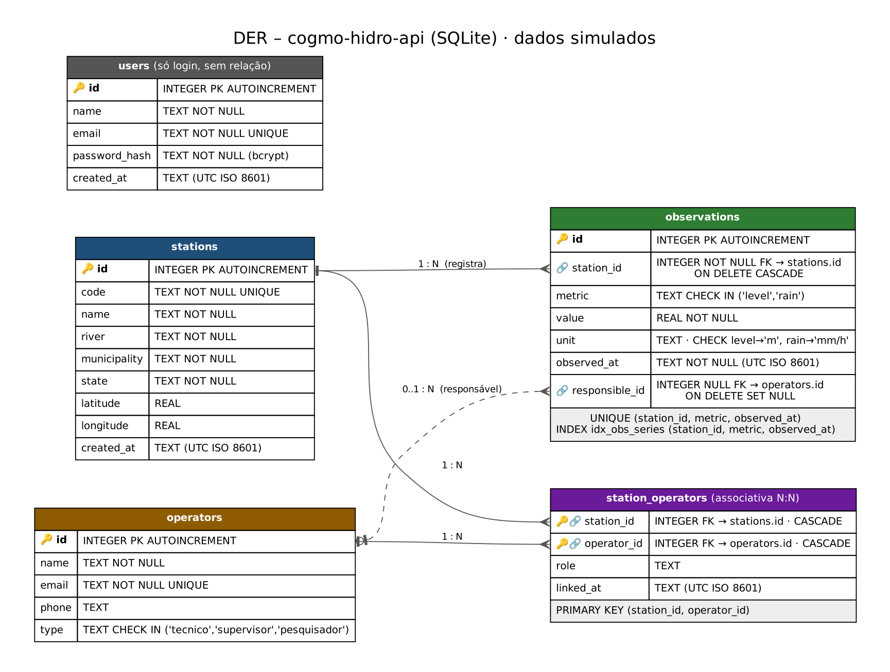

# API de Monitoramento Hidrológico – Cogmo

[](https://nodejs.org/) [](https://expressjs.com/) [](https://www.sqlite.org/) [](https://opensource.org/licenses/MIT)

> ⚠️ **Dados simulados.** As estações e leituras desta API são fictícias, usadas apenas para fins didáticos. Não descrevem rios reais e não podem embasar alertas ou decisões.

## Instituições de Fomento e Parceria

[](https://www.ifb.edu.br/) [](https://hardware.org.br/)

## Orientador

Prof. Tiago Segato

## Equipe

| Papel | Integrante | GitHub |
| --- | --- | --- |
| P1 · Banco de dados | Daltro Oliveira Vinuto | https://github.com/Daltro-Oliveira-Vinuto |
| P2 · Estações + Dashboard | Kyara Esteves de Sousa | https://github.com/Kyara2 |
| P3 · Observações + Série | Márcio Liberato (assumiu a parte) | [@mvictorliberato-maker](https://github.com/mvictorliberato-maker) |
| P4 · Autenticação + Operadores | Laércio | [@Laercio13](https://github.com/Laercio13) |
| P5 · Tech lead / QA / Documentação | Márcio Liberato | [@mvictorliberato-maker](https://github.com/mvictorliberato-maker) |

## Sumário

- [Visão Geral](#visão-geral)
- [Pacotes Utilizados](#pacotes-utilizados)
- [Estrutura do Projeto](#estrutura-do-projeto)
- [Diagrama de Banco de Dados](#diagrama-de-banco-de-dados)
- [Documentação da API](#documentação-da-api)
- [Configuração do Ambiente](#configuração-do-ambiente)
- [Decisões Técnicas](#decisões-técnicas)
- [Deploy](#deploy-opcional)

## Visão Geral

API REST que lista estações hidrológicas fictícias e entrega leituras de **nível de rio (m)** e **chuva (mm/h)** ao longo do tempo. Desenvolvida para o desafio de formação da Cogmo Technology e para o Projeto Integrador do curso de back-end.

O sistema gerencia três entidades relacionadas:

- **Estação** – ponto de monitoramento (rio, município, coordenadas)
- **Observação** – leitura de nível ou chuva em um horário UTC
- **Operador** – técnico, supervisor ou pesquisador vinculado às estações

Também oferece autenticação JWT para proteger as rotas de escrita.

## Pacotes Utilizados

| Pacote | Versão | Descrição |
| --- | --- | --- |
| express | ^5 | Servidor HTTP e rotas |
| better-sqlite3 | ^13 | Acesso ao banco SQLite |
| jsonwebtoken | ^9 | Geração e validação de tokens JWT |
| bcryptjs | ^3 | Hash de senhas |
| dotenv | ^18 | Variáveis de ambiente |
| cors | ^2 | Liberação de acesso para o frontend local |
| swagger-ui-express | ^5 | Documentação interativa da API |
| nodemon (dev) | ^3 | Reinício automático em desenvolvimento |

> **Nota:** consulte o `package.json` para a lista completa e as versões exatas.

## Estrutura do Projeto

```
cogmo-hidro-api/
├── package.json
├── .env.example
├── docs/
│   ├── der.png               # Diagrama Entidade-Relacionamento
│   ├── mer.png               # Modelo conceitual
│   ├── roteiro-demo.md       # Roteiro da apresentação
│   └── diario/               # Diário de trabalho por sprint
├── requests/
│   └── api.http              # Chamadas de teste prontas
└── src/
    ├── server.js             # Sobe o servidor
    ├── app.js                # Configura Express, middlewares e rotas
    ├── config/               # Leitura de variáveis de ambiente
    ├── docs/                 # Especificação OpenAPI (Swagger em /api/docs)
    ├── database/             # Conexão, migrations e seed
    ├── middlewares/          # Autenticação, aviso de dados simulados, erros
    ├── utils/                # Validadores e classe de erro
    ├── routes/               # Definição das rotas
    ├── controllers/          # Recebem a requisição e devolvem a resposta
    ├── services/             # Regras de negócio
    └── repositories/         # Consultas SQL parametrizadas
```

## Diagrama de Banco de Dados

<!-- TODO (P1): adicionar docs/der.png -->


> **Descrição:** <!-- TODO (P1): descrever entidades, relacionamentos (1:N, N:N, 1:N responsável) e campos críticos -->

## Documentação da API

A documentação interativa fica em **`http://localhost:3000/api/docs`** (Swagger UI) com o servidor rodando. Para testar rotas com cadeado, faça login em `POST /auth/login`, copie o `token` e clique em **Authorize**. A especificação está em [`src/docs/openapi.js`](src/docs/openapi.js).

### Endpoints Principais

Leitura de estações e leituras é pública; toda escrita exige `Authorization: Bearer <token>`. Rotas de operadores exigem token em tudo, porque têm e-mail e telefone. Exemplos prontos de cada chamada (inclusive os erros) estão em [`requests/api.http`](requests/api.http).

**Contrato Cogmo**

| Método | Endpoint | Descrição | Autenticação |
| --- | --- | --- | --- |
| GET | `/api/stations` | Lista as estações | Pública |
| GET | `/api/stations/{id}/summary` | Última leitura de nível (m) e de chuva (mm/h) | Pública |
| GET | `/api/stations/{id}/series?metric=level&hours=24` | Série de nível (m), `hours` de 1 a 72 | Pública |
| GET | `/api/stations/{id}/series?metric=rain&hours=24` | Série de chuva (mm/h), `hours` de 1 a 72 | Pública |

**Autenticação**

| Método | Endpoint | Descrição | Autenticação |
| --- | --- | --- | --- |
| POST | `/api/auth/register` | Cria usuário (senha com bcrypt) | Pública |
| POST | `/api/auth/login` | Retorna token JWT (validade 1 h) | Pública |

**CRUD das 3 entidades**

| Método | Endpoint | Descrição | Autenticação |
| --- | --- | --- | --- |
| GET | `/api/stations/{id}` | Busca uma estação | Pública |
| POST / PUT / DELETE | `/api/stations` · `/api/stations/{id}` | Cria, edita e remove estação | Token |
| GET | `/api/observations?station_id=&metric=` | Lista leituras (filtros opcionais) | Pública |
| GET | `/api/observations/{id}` | Busca uma leitura | Pública |
| POST / PUT / DELETE | `/api/observations` · `/api/observations/{id}` | Cria, edita e remove leitura | Token |
| GET / POST / PUT / DELETE | `/api/operators` · `/api/operators/{id}` | CRUD de operadores | Token |

**Relacionamentos e rota composta**

| Método | Endpoint | Relação | Autenticação |
| --- | --- | --- | --- |
| GET | `/api/stations/{id}/observations` | 1:N Estação → Leituras | Pública |
| POST | `/api/stations/{id}/observations` | 1:N Estação → Leituras | Token |
| GET | `/api/stations/{id}/operators` | N:N Estação ↔ Operadores | Token |
| POST | `/api/stations/{id}/operators` | N:N vincular (`{ operator_id, role }`) | Token |
| DELETE | `/api/stations/{id}/operators/{operatorId}` | N:N desvincular | Token |
| GET | `/api/observations/{id}/responsible` | 1:N Operador → Leituras (só id, nome e tipo) | Pública |
| PUT | `/api/observations/{id}/responsible` | Troca o responsável (`{ operator_id }`) | Token |
| GET | `/api/stations/{id}/dashboard` | Estação + leituras 24 h com responsável + operadores | Pública |

**Formato de erro** (igual em todas as rotas):

```json
{ "error": { "code": "INVALID_METRIC", "message": "metric deve ser level ou rain" } }
```

Status usados: 200, 201, 204, 400 (dado inválido), 401 (sem token), 404 (não existe), 409 (duplicado), 500 (erro inesperado, sem expor detalhes).

> **Detalhes:** consulte o Swagger para schemas de request/response, parâmetros e exemplos.

## Configuração do Ambiente

1. **Clone o repositório:**
   ```bash
   git clone https://github.com/cogmo-hidro-api/cogmo-hidro-api.git
   cd cogmo-hidro-api
   ```
2. **Instale as dependências** (Node.js 20 ou superior):
   ```bash
   npm install
   ```
3. **Configure as variáveis de ambiente:**
   ```bash
   cp .env.example .env
   # Edite o .env e troque o JWT_SECRET
   ```
4. **Crie e popule o banco:**
   ```bash
   npm run db:reset
   ```
5. **Inicie o servidor:**
   ```bash
   npm run dev
   ```
   Acesse `http://localhost:3000/api/health` – a resposta deve ser `{ "ok": true }`.
6. **Confira as rotas** (em outro terminal, com a API rodando):
   ```bash
   npm run test:smoke   # ou: bash scripts/smoke-test.sh
   ```

### Ubuntu (instalação automática)

No Ubuntu 22.04/24.04 (ou WSL), o script abaixo faz os passos 2 a 4 sozinho: instala `git`, `curl`, `build-essential` e `python3` (necessários para o `better-sqlite3`), instala o Node.js 22 LTS se não houver Node 20+, roda `npm ci`, cria o `.env` com um `JWT_SECRET` aleatório e prepara o banco.

```bash
git clone https://github.com/cogmo-hidro-api/cogmo-hidro-api.git
cd cogmo-hidro-api
bash scripts/setup-ubuntu.sh          # opções: --fresh (recria o banco), --run (já sobe a API), --skip-apt
```

### Scripts do npm

| Comando | O que faz |
| --- | --- |
| `npm run dev` | Sobe a API com recarga automática (nodemon) |
| `npm start` | Sobe a API sem recarga |
| `npm run db:migrate` | Cria as tabelas (pode repetir: `CREATE TABLE IF NOT EXISTS`) |
| `npm run db:seed` | Insere os dados fictícios (pode repetir sem duplicar) |
| `npm run db:reset` | `db:migrate` + `db:seed` |
| `npm run db:fresh` | Apaga o arquivo do banco e roda `db:reset` (banco limpo para a demo) |
| `npm run test:smoke` | Testa as rotas principais com `curl` (precisa da API rodando) |

## Decisões Técnicas

- Horários sempre em **UTC, formato ISO 8601**.
- Nível em **metros (m)**, chuva em **milímetros por hora (mm/h)**; o banco impede misturar métrica e unidade.
- **Lacunas não são preenchidas**: hora sem leitura simplesmente não aparece na série.
- A janela de horas da série termina na **última leitura da estação**, porque o seed usa datas fixas para ser repetível.
- Todas as consultas SQL são **parametrizadas**.
- O aviso de **dados simulados** (`simulated` e `notice`) é colocado por um único middleware em `/api`, então nenhuma rota esquece.
- Rotas que mostram **e-mail e telefone** de operador exigem token; a rota pública de responsável mostra só id, nome e tipo.
- Leitura repetida (mesma estação, métrica e horário) dá **409**, garantido também pelo `UNIQUE` no banco.

## Deploy (opcional)

Fora do escopo do desafio. A aplicação roda apenas localmente.
